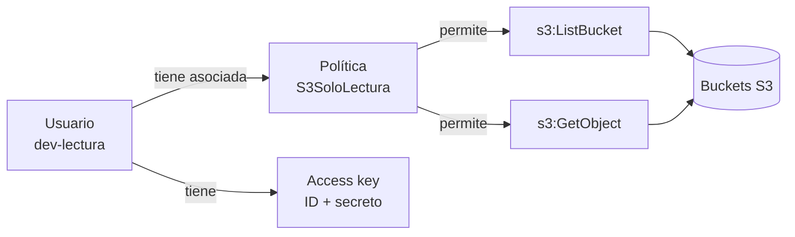
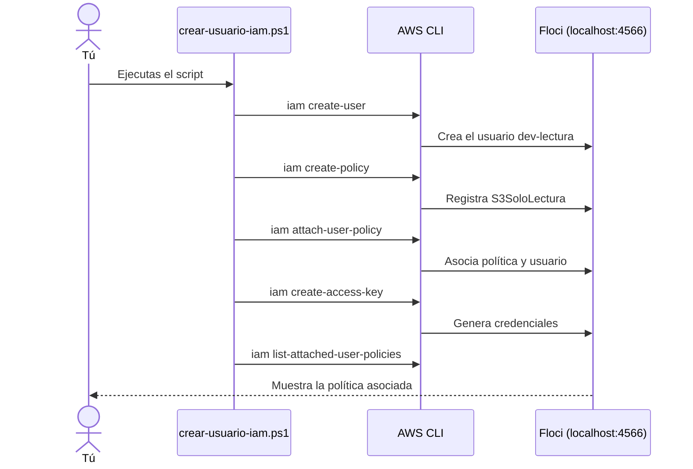
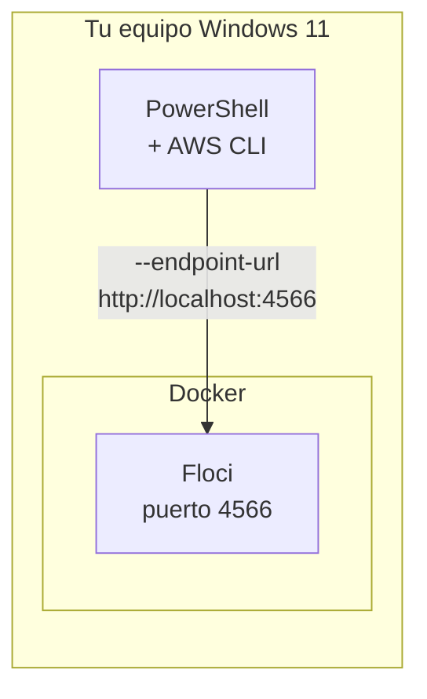
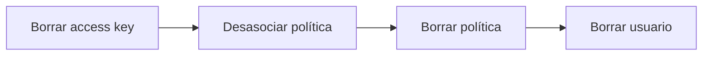
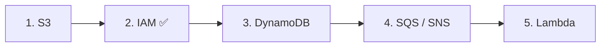

# Práctica 2: IAM con Floci

Crear un usuario IAM, una política de solo lectura sobre S3, asociarla al usuario y generar sus credenciales, todo en local con [Floci](https://floci.io/floci/).

> **Nivel:** Fundamentos · **Servicio AWS:** IAM · **Tiempo estimado:** 15 minutos

---

## Tabla de contenido

1. [Objetivo](#1-objetivo)
2. [Conceptos de teoría](#2-conceptos-de-teoría)
3. [Arquitectura de la práctica](#3-arquitectura-de-la-práctica)
4. [Requisitos](#4-requisitos)
5. [Estructura de archivos](#5-estructura-de-archivos)
6. [Paso a paso](#6-paso-a-paso)
7. [Verificación](#7-verificación)
8. [Limpieza](#8-limpieza)
9. [Errores comunes](#9-errores-comunes)
10. [Buenas prácticas de seguridad](#10-buenas-prácticas-de-seguridad)
11. [Siguiente práctica](#11-siguiente-práctica)

---

## 1. Objetivo

Al terminar esta práctica sabrás:

- Qué es IAM y para qué sirve.
- Crear un **usuario** y una **política** con la AWS CLI.
- **Asociar** una política a un usuario.
- Generar una **access key** y verificar el resultado.

---

## 2. Conceptos de teoría

**IAM (Identity and Access Management)** responde a una pregunta: *¿quién puede hacer qué sobre qué recurso?*

| Concepto | Qué es | Ejemplo en esta práctica |
|---|---|---|
| **Usuario** | Identidad con credenciales fijas para una persona o aplicación | `dev-lectura` |
| **Política** | Documento JSON con los permisos | `S3SoloLectura` |
| **Grupo** | Conjunto de usuarios que comparten políticas | *(se verá más adelante)* |
| **Rol** | Identidad que se asume temporalmente, sin credenciales fijas | *(práctica siguiente)* |
| **Access key** | Par de credenciales (ID + secreto) para usar la CLI o un SDK | Se genera en el paso 4 |

### Anatomía de una política

```json
{
  "Version": "2012-10-17",
  "Statement": [
    {
      "Effect": "Allow",
      "Action": ["s3:ListBucket", "s3:GetObject"],
      "Resource": ["arn:aws:s3:::*"]
    }
  ]
}
```

- `Effect`: `Allow` (permite) o `Deny` (deniega).
- `Action`: operaciones permitidas, con formato `servicio:Operación`.
- `Resource`: sobre qué recursos aplica, identificados por su **ARN**.

### Principio de mínimo privilegio

Se concede **solo** lo necesario para la tarea. Por eso esta política permite listar y leer objetos de S3, pero no escribir ni borrar.

---

## 3. Arquitectura de la práctica

### 3.1 Relación entre los recursos



### 3.2 Flujo del script



### 3.3 Dónde corre cada cosa



---

## 4. Requisitos

- Windows 11 con **PowerShell**.
- **Floci** en ejecución (escuchando en `http://localhost:4566`).
- **AWS CLI** instalada. Comprueba con:

```powershell
aws --version
```

- Haber completado la [Práctica 1 (S3)](../01-s3-bucket/README.md) es recomendable, aunque no obligatorio.

---

## 5. Estructura de archivos

```
02-iam/
├── README.md
├── crear-usuario-iam.ps1
└── politica-s3-lectura.json
```

---

## 6. Paso a paso

### Paso 0. Configurar el entorno

Floci acepta cualquier credencial, así que usamos valores ficticios. Estas variables solo duran mientras la ventana de PowerShell esté abierta.

```powershell
$env:AWS_ENDPOINT_URL = "http://localhost:4566"
$env:AWS_ACCESS_KEY_ID = "test"
$env:AWS_SECRET_ACCESS_KEY = "test"
$env:AWS_DEFAULT_REGION = "us-east-1"
```

### Paso 1. Crear el archivo de la política

Guarda como `politica-s3-lectura.json`:

```json
{
  "Version": "2012-10-17",
  "Statement": [
    {
      "Effect": "Allow",
      "Action": ["s3:ListBucket", "s3:GetObject"],
      "Resource": ["arn:aws:s3:::*"]
    }
  ]
}
```

### Paso 2. Crear el script

Guarda como `crear-usuario-iam.ps1`:

```powershell
$env:AWS_ENDPOINT_URL = "http://localhost:4566"
$env:AWS_ACCESS_KEY_ID = "test"
$env:AWS_SECRET_ACCESS_KEY = "test"
$env:AWS_DEFAULT_REGION = "us-east-1"

$usuario = "dev-lectura"
$politica = "S3SoloLectura"
$arn = "arn:aws:iam::000000000000:policy/$politica"

Write-Host "1. Creando usuario..."
aws iam create-user --user-name $usuario

Write-Host "2. Creando política..."
aws iam create-policy --policy-name $politica --policy-document file://politica-s3-lectura.json

Write-Host "3. Asociando política al usuario..."
aws iam attach-user-policy --user-name $usuario --policy-arn $arn

Write-Host "4. Creando access key..."
aws iam create-access-key --user-name $usuario

Write-Host "5. Verificación:"
aws iam list-attached-user-policies --user-name $usuario
```

### Paso 3. Ejecutar

Desde la carpeta `02-iam`:

```powershell
.\crear-usuario-iam.ps1
```

Si PowerShell bloquea la ejecución de scripts:

```powershell
Set-ExecutionPolicy -Scope Process -ExecutionPolicy Bypass
```

### Qué hace cada comando

| Paso | Comando | Resultado |
|---|---|---|
| 1 | `aws iam create-user` | Crea el usuario `dev-lectura` |
| 2 | `aws iam create-policy` | Registra la política a partir del JSON |
| 3 | `aws iam attach-user-policy` | Vincula la política con el usuario |
| 4 | `aws iam create-access-key` | Genera `AccessKeyId` y `SecretAccessKey` |
| 5 | `aws iam list-attached-user-policies` | Lista las políticas del usuario |

> El ARN `arn:aws:iam::000000000000:...` usa el ID de cuenta por defecto de Floci. Si tu instancia usa otro, ajusta la variable `$arn`.

---

## 7. Verificación

Comprueba que los recursos existen:

```powershell
aws iam list-users
aws iam list-policies --scope Local
aws iam list-attached-user-policies --user-name dev-lectura
```

La última salida debe tener una forma similar a esta (ejemplo ilustrativo):

```json
{
    "AttachedPolicies": [
        {
            "PolicyName": "S3SoloLectura",
            "PolicyArn": "arn:aws:iam::000000000000:policy/S3SoloLectura"
        }
    ]
}
```

### Captura de tu ejecución

> Pega aquí una captura o la salida real de tu terminal.

### Nota sobre el alcance de Floci

Floci emula la **API** de IAM: los recursos se crean, se listan y se asocian. No des por hecho que aplica las políticas exactamente como AWS real (donde este usuario solo podría leer S3). Consulta la documentación de Floci para ver el nivel de soporte.

---

## 8. Limpieza

Borra los recursos en orden inverso al de creación:

```powershell
# Si creaste una access key, obtén su ID y elimínala:
aws iam list-access-keys --user-name dev-lectura
aws iam delete-access-key --user-name dev-lectura --access-key-id <ACCESS_KEY_ID>

aws iam detach-user-policy --user-name dev-lectura --policy-arn arn:aws:iam::000000000000:policy/S3SoloLectura
aws iam delete-policy --policy-arn arn:aws:iam::000000000000:policy/S3SoloLectura
aws iam delete-user --user-name dev-lectura
```



---

## 9. Errores comunes

| Síntoma | Causa probable | Solución |
|---|---|---|
| `Could not connect to the endpoint URL` | Floci no está corriendo | Inicia Floci y verifica el puerto 4566 |
| `aws : The term 'aws' is not recognized` | AWS CLI no instalada o fuera del PATH | Instala la CLI y reabre PowerShell |
| `EntityAlreadyExists` | El usuario o la política ya existen | Ejecuta primero la limpieza |
| `NoSuchEntity` al asociar | La política o el usuario no se crearon | Revisa los pasos 1 y 2 |
| Error al leer `file://politica-s3-lectura.json` | Ejecutas desde otra carpeta | Usa `cd` a la carpeta `02-iam` |
| Script bloqueado por PowerShell | Política de ejecución restrictiva | Usa el comando `Set-ExecutionPolicy` del paso 3 |

---

## 10. Buenas prácticas de seguridad

- **Nunca subas credenciales reales a Git.** Aunque aquí sean ficticias, crea el hábito.
- Añade a tu `.gitignore` cualquier archivo que guarde claves:

```
*.key
credenciales*.txt
.env
```

- En AWS real, evita `"Resource": "*"` y limita cada política a los recursos necesarios.
- Prefiere **roles** sobre usuarios con access keys de larga duración.

---

## 11. Siguiente práctica

**Práctica 3: DynamoDB.** Crearemos una tabla, insertaremos ítems y los consultaremos.

